# Warp Capacity

**Resource planning for Filament. See who works on which project, how much, week by week — and drag to change it. Book roles before you know who, keep tentative projects apart, try a plan in a scenario before it is real, compare demand with the people you have, collect weekly timesheets, and watch each budget burn against the plan.**

<a href="https://demo.warpui.com/capacity"></a>

Drag a booking to another week or another person, replace a placeholder with someone who has the time, open a scenario for a project you might win, then see the shortfall by role and the budget of each project — at **[demo.warpui.com/capacity](https://demo.warpui.com/capacity)**. No sign-up needed; the data is reset every hour.

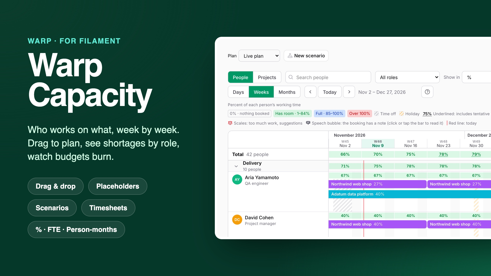

- [What it does](#what-it-does)
- [Installation](#installation)
  - [AI coding assistants (Laravel Boost)](#ai-coding-assistants-laravel-boost)
- [Quick start](#quick-start)
- [How the numbers are counted](#how-the-numbers-are-counted)
- [The planner](#the-planner)
- [Repeating bookings](#repeating-bookings)
- [Booking requests and approval](#booking-requests-and-approval)
- [Fixing an overbooked person](#fixing-an-overbooked-person)
- [Placeholders](#placeholders)
- [Tentative projects](#tentative-projects)
- [Scenarios](#scenarios)
- [Baselines](#baselines)
- [Demand and supply](#demand-and-supply)
- [Hiring forecast](#hiring-forecast)
- [Timesheets](#timesheets)
- [Projects, budgets and money](#projects-budgets-and-money)
- [Phases and milestones](#phases-and-milestones)
- [Billable utilization](#billable-utilization)
- [Billing](#billing)
- [Work reports](#work-reports)
- [People, roles, time off and holidays](#people-roles-time-off-and-holidays)
- [Calendar feeds](#calendar-feeds)
- [Importing from a CSV file](#importing-from-a-csv-file)
- [On your own pages](#on-your-own-pages)
- [Using it from code](#using-it-from-code)
- [Who can do what](#who-can-do-what)
- [Plugin options](#plugin-options)
- [Using your own time off and actuals](#using-your-own-time-off-and-actuals)
- [Multi-tenancy](#multi-tenancy)
- [Requirements](#requirements)

## What it does

| | |
| --- | --- |
| **A plan you can drag** | People down the side, weeks across the top. Each booking is a bar: drag it to another week or another person, drag its ends to make it longer, hold Alt to copy it, drag across an empty row to book someone. Undo and redo with the keyboard. |
| **How full everyone is, at a glance** | A strip above each person shows each week in green (room), blue (85–100%, full) or red (over 100%), with time off and holidays taken away. Teams and the whole company have the same strip. |
| **Any unit your team thinks in** | Percent of each person’s time, hours, FTE or person-months (人月). Switch at any time; nothing is reloaded. Book in % of their time, hours a day, hours a week or FTE. |
| **Roles before people** | Book “a designer, 50%, from March” before you know who. Later, *Find someone* lists the people with that role and those skills who have the most free time then. |
| **Tentative work, honestly** | Projects you have not won yet are hatched. Count them fully, weigh them by their chance of winning, or leave them out. |
| **What-if scenarios** | Copy the plan, try winning a project or moving a team, compare, and apply it to the live plan when you are sure. The live plan does not change until then. |
| **Demand against supply** | For each role and week: work booked, placeholders and tentative work against the working time of the people in it. Shortages are marked before they happen. |
| **Timesheets and budgets** | People fill in their week (or start from the plan), submit, and get approved or sent back. Each project shows hours and money spent, where it will end up, and the margin. |
| **Rates that change on a date** | Raise a role’s or a person’s rate from a date; hours before it keep the old rate, so revenue already earned does not move. |
| **Requests and approval** | Optionally, project managers *request* people instead of booking them. Requests show as dashed bars; someone who approves confirms them, books someone else or declines with a reason. |
| **Help when someone is overbooked** | One click on an overbooked person suggests a colleague with time, a later start or fewer hours a day — and makes the change you pick. |
| **Billable utilization against a target** | How much of each person’s time goes to billable work, planned and from timesheets, next to a target per person or role. |
| **Baselines, phases and a hiring forecast** | Keep the plan you promised and see what moved since. Give projects phases with their own budgets and milestones. See which role to hire for, how many, and when to start looking. |
| **From timesheet to invoice** | Close a month so its hours cannot change, export approved hours as invoice lines (also monthly fees with an hour range, and other currencies), print a monthly work report for the client. A timer fills the timesheet for you. |
| **Fits into your app** | Book from your own code with `Bookings::book()`, follow your Warp Scheduler tasks with `Bookings::sync()`, listen to events, give everyone their plan as a calendar link, import bookings and past hours from CSV. |
| **People hear about their plan** | When someone else changes their bookings, every Monday with their week, and when a timesheet is missing or sent back — by email or in the panel’s bell. |
| **Your models stay yours** | People and projects are your own Eloquent models. Warp Capacity only stores bookings, settings and timesheets in its own tables. |

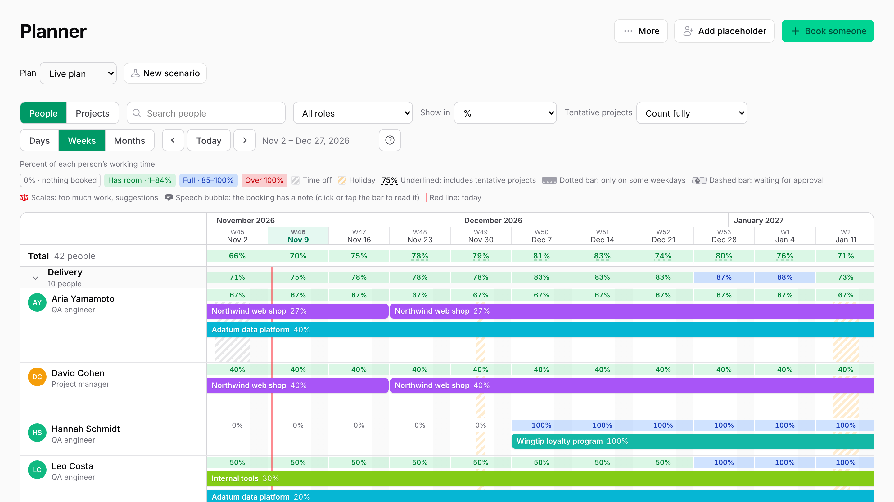

## Installation

> **Warp Capacity is a commercial plugin.** A license is required. After purchase you receive credentials for the private Composer repository.

Add the repository and authenticate:

```bash
composer config repositories.qalainau composer https://qalainau.privato.pub/composer
composer config --auth http-basic.qalainau.privato.pub "your-email" "your-license-key"
```

Install the package, run the migrations and publish Filament's assets:

```bash
composer require qalainau/filament-warp-capacity
php artisan migrate
php artisan filament:assets
```

The migration creates the `warp_capacity_*` tables (roles, people and project settings, placeholders, bookings, scenarios, time off, timesheets). Your tables are not changed. To edit the migration, publish it with `php artisan vendor:publish --tag=filament-warp-capacity-migrations`. Publish it before you run `php artisan migrate` for the first time: Warp Capacity then runs your copy instead of its own. If the tables already exist, change them with a migration of your own instead.

> Run `php artisan filament:assets` again after every update of the package.

### AI coding assistants (Laravel Boost)

Warp Capacity ships instructions for AI coding assistants such as Claude Code, Cursor and Codex. If your app uses
[Laravel Boost](https://laravel.com/docs/boost), the assistant learns how to use Warp Capacity from them: how to
register people and projects, book through the public API, handle units, permissions and tenancy, and test
resource planning.

- **Guidelines** (`resources/boost/guidelines/core.md`): a short summary that Boost adds to `CLAUDE.md`,
  `AGENTS.md` and the other agent files. It also points the assistant to this README in `vendor/`, so it reads the
  documentation of the version you have installed instead of guessing.
- **Skill** `warp-capacity-development` (`resources/boost/skills/`): the steps for registration, bookings, source
  synchronization, timesheets, money, tenancy and feature tests. The assistant loads it when it works on resource planning.

Boost does not add guidelines of other vendors' packages on its own. When `php artisan boost:install` asks
"Which third-party AI guidelines/skills would you like to install?", select `qalainau/filament-warp-capacity`. To do
it without the question, add the package to `boost.json` and run the command again:

```json
{
    "packages": ["qalainau/filament-warp-capacity"]
}
```

```bash
php artisan boost:install --guidelines --skills -n
```

## Quick start

**1. Register the plugin** with your people and project models:

```php
use App\Models\Employee;
use App\Models\Project;
use Qalainau\FilamentWarpCapacity\FilamentWarpCapacityPlugin;

public function panel(Panel $panel): Panel
{
    return $panel
        // ...
        ->plugin(
            FilamentWarpCapacityPlugin::make()
                ->people(Employee::class, title: 'name', group: 'department', query: fn ($query) => $query->where('active', true))
                ->projects(Project::class, title: 'name', subtitle: 'client.name', query: fn ($query) => $query->whereNull('closed_at'))
                ->personForUser(fn (User $user) => Employee::query()->where('user_id', $user->id)->first())
                ->currency('EUR'),
        );
}
```

| Argument | What it is |
| --- | --- |
| `people(model, title, group, query, tenantRelationship)` | The model of the people you plan. `title` is the name (an attribute, a dotted relation path or a closure `fn (Employee $person) => ...`). `group` puts people under a heading in the planner (a team, an office); leave it out for one flat list. `query` limits who is planned, for example without people who have left. `tenantRelationship` is for [multi-tenancy](#multi-tenancy). |
| `projects(model, title, subtitle, query, tenantRelationship)` | The model of your projects. `subtitle` is shown next to the name (a client). `query` limits the projects that can be **booked**; existing bookings on other projects are still shown. |
| `personForUser(fn)` | Who the signed-in user is in the plan, for *My timesheet*. Not needed when the people model **is** your user model. |

If your people are your users, `->people(User::class)` is enough.

**2. Open the panel.** Under **Capacity** you now have the *Planner*, *Demand and supply*, *Projects*, *My timesheet* and *Timesheet approvals*; under **Capacity settings**: *People*, *Roles* and *Time off and holidays*.

**3. Add roles** (Designer, Developer, Project manager…) with their bill and cost rates, and give each person a role and their working hours on the *People* page. Everyone without settings works Monday to Friday, 8 hours a day.

**4. Book people.** On the planner, drag across an empty row, or use **Book someone**.

## How the numbers are counted

A booking is *a person (or a placeholder) on a project, from a date to a date, for so many minutes a day*. Everything else is counted from that:

- A booking counts only on the person’s **working days**, inside their employment dates, and not on a **whole day off** (a holiday or their own time off). A half day off only reduces the working time; the booking still counts.
- **Working time** is the person’s hours for that weekday, minus holidays and time off.
- **Percent** is booked time ÷ working time. A week with a holiday is full sooner.
- **FTE** is booked time ÷ the working time of a full-time person (8 hours a day on the default working days, holidays taken away). 0.5 FTE is half a full-time person.
- **Person-months (人月)** add up month by month: booked time in a month ÷ the full-time working time of that whole month. A full-time person for all of March is 1.0, whatever the number of working days; two weeks of it is about 0.5.
- **Hours** are hours.

When you book someone in **% of their time**, the percentage is of *their* usual day: 50% of someone who works 6 hours a day is 3 hours. FTE and hours are the same for everyone.

The full-time day and the default working week can be changed:

```php
FilamentWarpCapacityPlugin::make()
    ->workWeek([8, 8, 8, 8, 8, 0, 0])   // Monday to Sunday, in hours
    ->fullTimeHoursPerDay(7.5)
    ->defaultUnit(Unit::PersonMonths)
```

## The planner

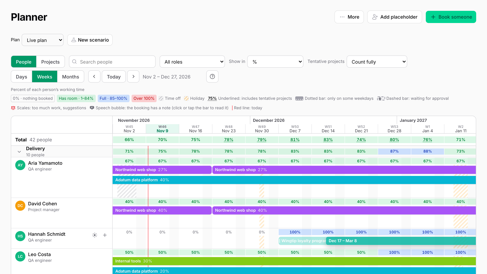

| To… | Do this |
| --- | --- |
| Book someone | Drag across an empty part of their row (a click books the week), or press **+** on their row, or **Book someone** at the top. |
| Move a booking | Drag the bar left or right, or up and down to another person. |
| Make it longer or shorter | Drag its left or right end. |
| Copy it | Hold **Alt** (Option on a Mac) while you drag. |
| Change how much, the project or the note, or delete it | Click the bar (or focus it and press Enter). |
| Cut a booking in two | Click the bar and press **Split**. See [below](#splitting-moving-several-bookings-and-shifting-a-project). |
| Move or delete several bookings at once | **Shift+click** the bars (or Ctrl+click, ⌘+click on a Mac), then drag one of them, or press **Delete**. **Esc** clears the selection. |
| Move a whole project earlier or later | In **Projects**, the two-arrows button on the project’s row. |
| Undo, redo | **Ctrl+Z** / **Ctrl+Shift+Z** (⌘Z / ⌘⇧Z on a Mac): drags, splits, deleting selected bars and project shifts. |
| Add time off | The sun button on the person’s row. |
| See by project | **Projects** at the top left: each project with the people on it. **+** on a project adds someone to it. The search finds projects by name as well as people. |
| Find who has time | **Find who is free** at the top. See [Finding people](#finding-people-skills-tags-free-time-and-saved-views). |
| Show only people with a skill or tag | **Skills and tags** in the toolbar. |
| Come back to the same filters | **Save this view** (the bookmark button), then pick it under **Saved view**. |
| Look further | Scroll sideways; earlier and later months load as you go. **Today** comes back. **Days / Weeks / Months** change the zoom. |

The lines above the grid say what the numbers mean in the unit you picked and what each colour, hatch, underline and bar style stands for (dotted: some weekdays only; dashed: waiting for approval; the scales: too much work; a speech bubble after the amount: the booking has a note). The red line is today; it runs under the bars, so it never hides their names. On a phone, **Options** opens the role, unit and tentative choices and this key.

The strip above each person counts **all** their bookings for each column. In the project view, it is still the person’s total, so you see when someone on your project is overbooked elsewhere. Project rows add up everyone on the project in the unit you picked; in %, it is a share of one full-time person (two people booked full time show 200%).

**Changes made elsewhere.** Every drag is saved at once. If someone else changed the same booking since your screen loaded it, the drag is not saved: you are told, and the plan is reloaded with their change. When you come back to the window after a while, the plan is reloaded too.

**Download** at the top writes the plan to Excel or CSV: one row per person and placeholder, one column per week or month, in the unit you choose. Overbooked cells are red in Excel.

Large teams are fine: only the rows on screen are drawn. The plan of 500 people over a year loads in under a second.

**More** at the top has the download, [importing bookings](#importing-from-a-csv-file) and [saving a baseline](#baselines).

## Finding people: skills, tags, free time and saved views

With fifty people or more the planner is a long list. Three things shorten it.

### Skills and tags

Each person has **skills** (with a level) and **tags** — short labels of your own such as *Remote*, *Berlin office* or *Contractor* — both set on *People* → the person. In the planner, **Skills and tags** in the toolbar lists every skill and tag in use. Tick some and only the people who have **all** of them stay; the totals at the top count only them. The search box finds people by skill and tag as well as by name.

### Find who is free

**Find who is free** at the top of the planner asks for two dates and, if you like, the free hours you need, roles, skills and tags. The planner then shows only the people who match, scrolled to the first date, with each person’s free hours under their name, and a message lists the five with the most free time. The bar above the grid says what you are looking at; **Show everyone again** on it brings the full list back.

How free time is counted:

- Free = working hours in the period (after time off, holidays, and before a start date or after an end date) − what is booked.
- Bookings on **tentative** projects and **requests** waiting for approval count as booked, so nobody is offered twice.
- With a scenario chosen, the scenario’s plan is used.
- Without *free hours needed*, everyone with any time left is listed. A period can be at most 366 days.
- Roles: any of the chosen ones. Skills and tags: all of the chosen ones, ignoring upper and lower case.

From code:

```php
use Qalainau\FilamentWarpCapacity\Availability;

$free = Availability::find(
    from: '2027-01-11',
    to: '2027-01-22',
    hours: 40,                      // optional: at least this many free hours
    roles: [$designer],             // optional: Role models or ids
    skills: ['Figma'],              // optional: has all of these
    tags: ['Remote'],               // optional: has all of these
    firmOnly: false,                // true: ignore tentative projects and requests
    scenario: null,                 // a scenario id to read its plan
);

$free->first();
// ['key' => '7', 'person' => Employee, 'name' => 'Mia Nakamura', 'role' => 'Designer', 'role_id' => 1,
//  'skills' => ['Figma'], 'tags' => ['Remote'], 'capacity' => 4800, 'booked' => 1200, 'free' => 3600, 'free_percent' => 75]
```

`capacity`, `booked` and `free` are minutes. The list is sorted by free time, most first. Only people of the current tenant who are in the planner (your `people()` query) are returned; `Availability` does not check permissions. `Availability::labelOptions()` returns the skills and tags in use: `['skills' => [...], 'tags' => [...]]`.

### Saved views

The bookmark button (**Save this view**) saves how the planner looks now under a name: People or Projects, the zoom, the unit, how tentative projects count, the search, the role and the ticked skills and tags. Choose it under **Saved view** to get the same planner back; the bin button next to it deletes the chosen view.

- A view is yours alone. People who may manage the settings can tick **Share with everyone who can open the planner**; shared views are marked in the list, and only those people can change or delete them.
- Saving under a name you already used replaces that view.
- Each person can keep 30 views. The scenario and the dates on screen are not part of a view.

## Splitting, moving several bookings and shifting a project

When a project slips, or someone is pulled off it for two weeks, you rarely change one booking. These three tools change many at once, and each can be undone with **Ctrl+Z** (⌘Z) while the planner stays open.

### Split a booking in two

Click a bar at the week where you want to cut it and press **Split**. The form asks for the day the second part starts and fills in the day you clicked (the Monday of that week in the Weeks zoom; today or the middle of the booking when that day cannot be cut). The first part ends the day before. Both parts keep the person, project, amount, note, phase and weekdays, so you can then move, shorten or delete one of them: *“Anna is off the project for the first two weeks of March”* is a split, a second split and a delete.

- The day must be after the booking’s first day and no later than its last, so both parts keep at least one day. A one-day booking has no **Split** button.
- A booking that repeats *every 2 weeks* (or 3, 4) keeps counting the same weeks: the second part starts on the Monday of the next counted week.
- A request stays a request: both parts wait for approval.
- Bookings that [follow your own data](#following-your-own-data-warp-scheduler-tasks-orders-) cannot be split, also not from code: one record of yours stays one booking.
- **Ctrl+Z** joins the two parts again.

### Select several bars and move them together

**Shift+click** a bar (or Ctrl+click, ⌘+click on a Mac) to select it; click more bars the same way. Selected bars get a dark outline, and a bar at the bottom of the screen says how many are selected, with **Delete selected** and **Clear selection**.

- **Drag one of them** and they all move by the same number of days.
- **Rows:** if every selected bar is on the same person’s row, dropping them on another person (or placeholder) moves them all there. Bars from different rows keep their rows and only change dates, so a group is never collapsed onto one person by accident. A group never changes project.
- **Delete selected** (or the Delete key) deletes them without asking; the message says how to bring them back, and **Ctrl+Z** does. Bookings brought back are new bookings with the same person, project, dates, amount, note, phase and weekdays.
- **All or nothing.** If one of the bars cannot be changed — someone else changed it meanwhile, it comes from other data, or it is a confirmed booking and you can only send requests — none of them is moved or deleted. You are told why and the plan is reloaded.
- Bars you may not change cannot be selected (Shift+click opens them, with the reason). At most 200 bars at a time.

### Shift a whole project

In **Projects**, press the two-arrows button on a project’s row. Choose **Later** or **Earlier**, by how many **weeks** or **days** (up to 730 days), and press **Shift**. Every booking of the project moves by that much.

| Field | What it does |
| --- | --- |
| **Move**, **By**, **Unit** | Direction and distance. Whole weeks keep every booking on the same weekdays; days are calendar days, weekends included. |
| **Only what starts on or after** | Leave empty to move everything, past bookings too. With a date, bookings and phases that start before it stay — use it to keep the weeks already worked where they were. A booking that started before the date and is still running stays as well; [split](#split-a-booking-in-two) it first to move the rest. |
| **Also move the phases and milestones** | Moves the project’s [phases and milestones](#phases-and-milestones) by the same number of days. |

- **Skipped, not blocked.** Bookings that follow your own data (the ones with a link icon), and confirmed bookings when you can only send requests, stay where they are. The message afterwards says how many were moved and how many were left, so a project with a few locked bookings can still be shifted. Anything else that goes wrong (someone changing a booking at that very moment) cancels the whole shift.
- **Who can move phases.** Bookings move for everyone who can plan (`canPlan`). Phases and milestones move only for people who manage the settings (`canManage`), the same people who can edit them under *Projects → Phases*; for the others the switch is replaced by a line saying the phases stay.
- **In a scenario** the bookings move inside the scenario and the live plan does not change. Phases and milestones are not part of a scenario, so they stay; the form says so. Change their dates under *Projects → Phases* when you apply the scenario.
- **Ctrl+Z** moves back exactly what was moved — the same bookings, phases and milestones — and nothing else.
- Requests move like other bookings and stay requests. Baselines are copies and do not change, so a shifted project shows as *Changed* when you compare. Timesheets and approved hours are not touched.

## Repeating bookings

Not every booking is every day. In the booking form, **Only on** picks the weekdays (the weekly stand-up, “Tuesdays at the client”) and **Repeat** every 1 to 4 weeks. Leave the days unticked to count every working day.

- Only the chosen days count — in the strip, *Demand and supply*, the timesheet’s plan, the money and the reports. “4 h on Mondays every 2 weeks” over a month is 8 or 12 hours, not 80.
- The bar still spans its dates and shows the days (`50% · Mon, Wed /2 wk`; one letter each in languages where every weekday has its own, like `月·水`); hover it for the full rule. In a [calendar feed](#calendar-feeds) it becomes a repeating event.
- Ticking every day is the same as ticking none.

## Booking requests and approval

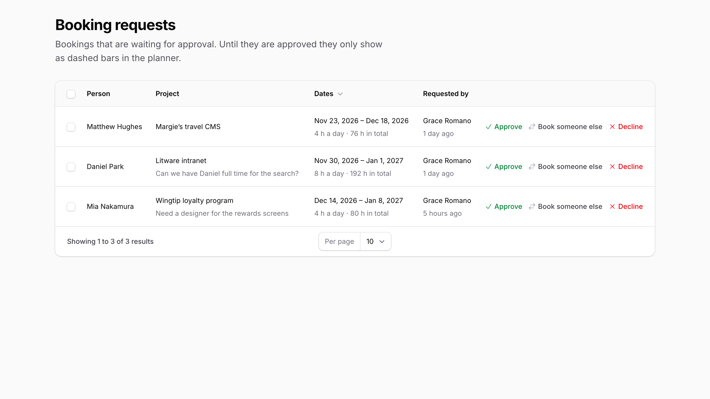

In larger teams, project managers do not book people themselves: they ask a resource manager. Turn this on with:

```php
FilamentWarpCapacityPlugin::make()
    ->bookingRequests()
    ->canApproveBookings(fn (User $user) => $user->hasRole('resource-manager'))   // default: canManage
```

- When someone who can plan but **cannot approve** books a person, the booking is saved as a **request**: a dashed bar with a clock. They can still move, change or delete their requests, but not confirmed bookings, and they cannot apply scenarios (that would skip the approval).
- People who can approve book directly, as before.
- *Requests* (with the number waiting in the menu) lists them with the hours, who asked and when. **Approve**, **Book someone else** (confirms it with another person) or **Decline** with a reason. Several can be approved at once.
- Until it is approved, a request counts like a [tentative project](#tentative-projects): it shows on the strips (and can be left out with the same menu), but not in the money, the timesheet’s plan or the person’s notifications. Once approved, the person is told like for any other change.
- With [notifications](#notifications) on, the person who asked is told when their request is approved or declined (with the reason). They are found as a user of the panel; that user must be notifiable.

## Fixing an overbooked person

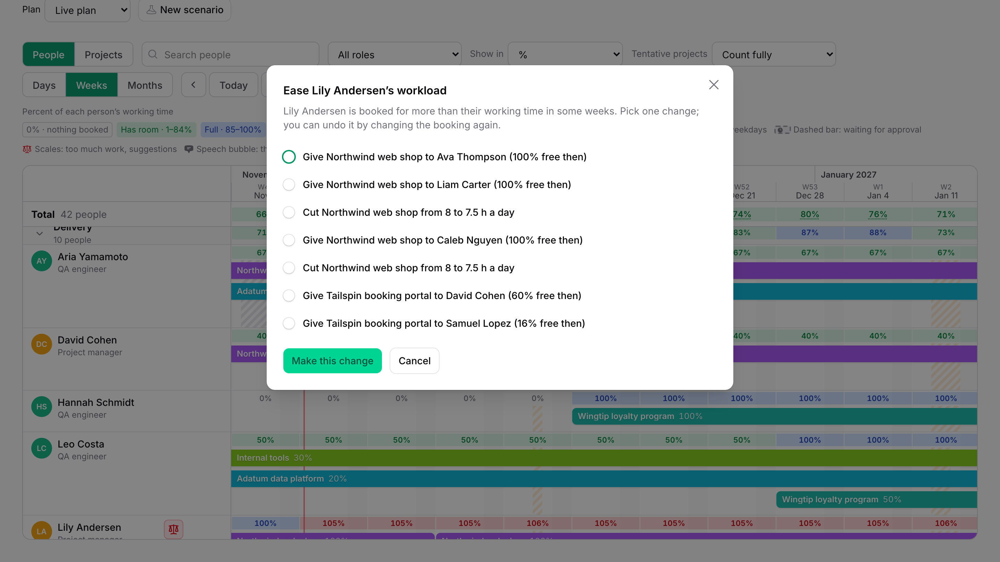

When someone is booked for more than their working time in a week you can see, their row gets a red scales button. It opens a short list of ways out, for each booking in the overbooked weeks:

- **Give it to someone else** — up to two people (the same role first) who are free for the whole booking, with how free they are;
- **Move it later** — the smallest shift, up to 8 weeks, after which the person is no longer overbooked;
- **Cut it** — the hours a day that fit the worst week, rounded down to 15 minutes.

Pick one and **Make this change**; it is saved like a drag (and can be changed back the same way). Only confirmed work counts: requests and tentative projects do not. Bookings that come from your own data (`Bookings::sync()`) are never suggested. Works in scenarios too.

## Placeholders

A placeholder books a **role** instead of a person: “Designer, 50%, for six weeks from 2 March”. Use **Add placeholder**, choose the role, optionally the skills needed, the project, the dates and how much.

Placeholders appear under **Unfilled roles** at the bottom of the planner and count as demand for their role. When you know who will do the work, press **Find someone** on the placeholder: the list puts first the people with the same role, then those with the skills, then those with the most free time during the placeholder’s weeks — for example *Mia Chen — Designer · 70% free · 1/1 skills*. All bookings of the placeholder move to the person you pick, and the placeholder is removed.

## Tentative projects

Mark a project as **tentative** with its **chance of winning** in its settings (on the *Projects* page). Its bookings are hatched in the planner. The **Tentative projects** menu on the planner and on *Demand and supply* decides how they count:

- **Count fully** — as if you had won it;
- **Weigh by chance** — 60% chance × 10 days = 6 days;
- **Leave out** — hidden and not counted.

## Scenarios

**New scenario** starts a copy of the plan, for example *“Win Woodgrove”*. Everything you change while the scenario is selected — moving, adding, deleting, replacing placeholders — is kept in the scenario; the live plan does not change. Changed bookings have a dot.

Switch between the live plan and the scenario at the top of the planner, and compare them on *Demand and supply*: with a scenario selected, the chart draws the live plan’s demand as a dashed line.

**Apply to live plan** writes the scenario into the live plan: it tells you how many bookings will be added, changed and deleted, and how many of those were also changed in the live plan meanwhile (the scenario’s version wins). **Delete scenario** throws it away.

## Baselines

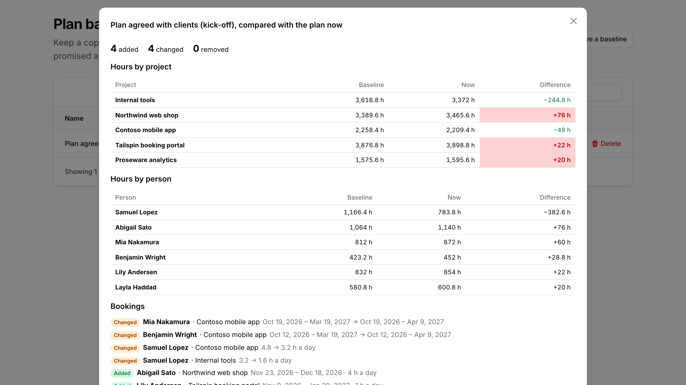

A scenario is a plan you might do; a **baseline** is the plan you agreed on. **Save a baseline** (on *Baselines*, or under **More** in the planner) keeps a copy of every confirmed booking as it is now, for example *“Plan agreed with Acme, 3 Nov”*. The plan itself does not change.

Later, **Compare with now** shows:

- how many bookings were added, changed and removed since, and what changed in each (“Nov 2 – Nov 13 → Nov 9 – Nov 20”, “8 → 4 h a day”, “Alice → Bob”);
- the hours of each project then and now, with the difference — the slip you need to explain to the client;
- the hours of each person then and now.

Hours are counted with today’s calendar (time off added since then is taken into account on both sides). Requests are not part of a baseline.

## Demand and supply

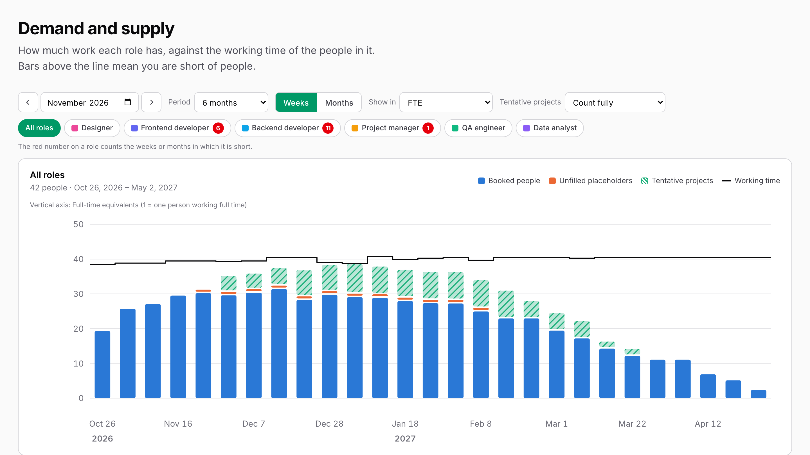

For each role, week by week (or month by month): stacked bars of the work **booked** on people with that role, **unfilled placeholders** of that role and **tentative** work, against a line of the **working time** of the people with that role. Bars above the line mean you are short of people. The tabs show how many periods each role is short in, and a table below gives every role and period as *work / working time*, with ▲ where work is more.

Choose the first month, 3 to 18 months, weeks or months, and FTE, hours or person-months.

## Hiring forecast

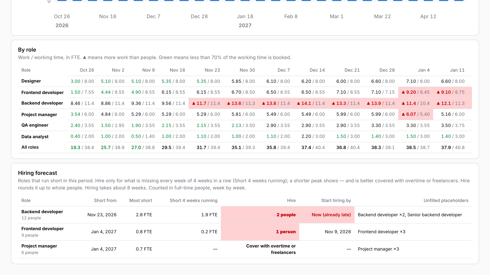

Under the table, *Hiring forecast* turns the shortages into a hiring plan, for each role that is short in the period:

| Column | What it is |
| --- | --- |
| Short from | The first week where work (booked + placeholders + tentative, as chosen above) is more than the working time. |
| Most short | The largest shortage in any week, in full-time people. |
| Short 4 weeks running | The shortage that lasts **4 weeks in a row** (the smallest of those 4 weeks, at its highest). A shorter peak shows — : it is not a reason to hire. |
| Hire | That number rounded up: *2 people*. Zero means: cover the peak with overtime or freelancers. |
| Start hiring by | *Short from* minus the time hiring takes. “Now (already late)” when that date has passed. |
| Unfilled placeholders | The placeholders of that role in the period, often the jobs to advertise. |

It is always counted week by week in FTE, whatever the chart shows, and follows the scenario you selected. Set how long hiring takes with `->hiringLeadTime(12)` (weeks, default 8).

## Timesheets

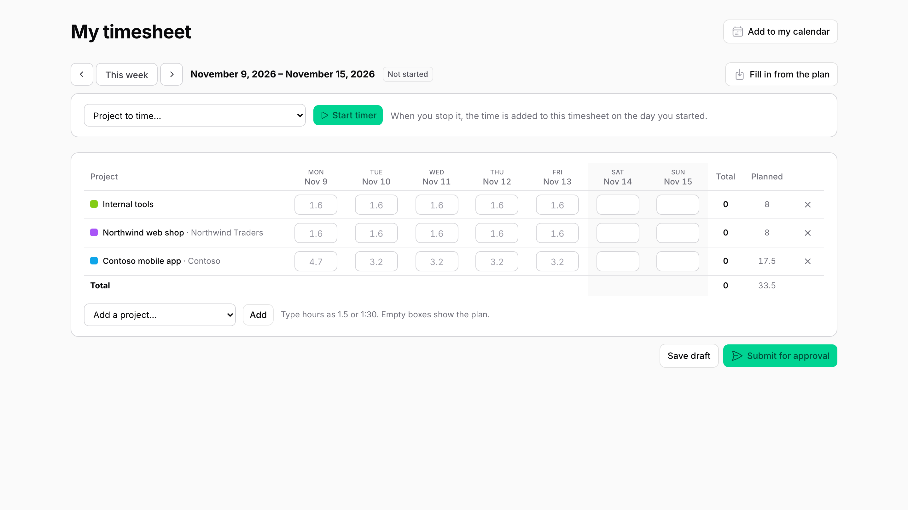

*My timesheet* is one week: a row per project, a box per day. Empty boxes show the planned hours in grey; **Fill in from the plan** copies them in. Hours can be typed as `1.5`, `1,5` or `1:30`. The table shows each row’s total against the plan.

- **Save draft** keeps it; **Submit for approval** sends it. A submitted week cannot be changed; **Take back to change** brings it back while it is waiting.
- On *Timesheet approvals* (with a count of waiting weeks in the menu), approvers see hours against the plan, open a week, **Approve** it or **Send back** with a reason. The reason is shown on the person’s timesheet, who corrects it and submits again. Several weeks can be approved at once.
- No day can have more than 24 hours. A week saved in another window is not overwritten.

**Timer.** At the top of *My timesheet*, pick a project and **Start timer**. **Stop and add** puts the time into the timesheet on the day it started (added to what is there). Starting another project stops the running one first. If that week was submitted in the meantime, the timer keeps running and you are told why. **Discard** throws it away. Each person has one timer, kept on the server, so it survives closing the browser and works from a phone.

**Closing a period.** On *Timesheet approvals*, **Close timesheets** up to a date (say, the end of last month) once pay and invoices are done. Weeks that start on or before that date can no longer be saved, submitted, taken back, approved or sent back — the hours used for pay and invoices stay as they were. The dialog says how many timesheets before that date are not approved yet. **Open them again** removes the closing.

**Importing past hours.** **Import past hours** on *Timesheet approvals* reads a CSV file from your old time tracking (see [Importing from a CSV file](#importing-from-a-csv-file)).

### Work types

An invoice or a report often has to say what the hours were for: *Design*, *Development*, *Meetings*. **Work types** put that on the timesheet. Until you create one, nothing changes: a project is one row.

- Create them on *Projects*: **Work types** in a project’s ⋮ menu for that project, or **Work types for every project** at the top for ones every project can use. Each has a name and a **Billable** switch.
- On *My timesheet*, choosing a project under the table now also offers its work types (and *No work type*). Each project × work type is its own row, so a person can enter 5 hours of *Development* and 1 hour of *Meetings* on the same project and day. The 24-hours-a-day limit counts all rows together.
- **Fill in from the plan** and the **timer** use the row without a work type; rows with a work type stay as they are.
- Approvers see the work type next to the project on *Timesheet approvals*.
- The [work report](#work-reports) lists the hours by work type under the table.
- [Billing](#billing) has **By work type** next to *By person* and *By role*: one line per project and work type (`groupBy: 'work_type'` in `Billing::lines()`; the line’s `key` is `type:<id>`, or `type:0` for hours without one).
- Hours of a work type that is **not billable** (say, internal meetings) count as cost, but not as revenue on *Projects*, and they are left out of every billing line.
- A work type that already has hours is never deleted: removing it only stops people from choosing it, so old timesheets, reports and invoices keep its name. A work type without hours is deleted.
- Managing work types is for people who may manage the settings.

```php
use Qalainau\FilamentWarpCapacity\WorkTypes;

WorkTypes::create('Development');                              // for every project
WorkTypes::create('Meetings', $project, billable: false);      // for one project, not billed
WorkTypes::for($project);                                      // what can be chosen on a project
WorkTypes::remove($type);                                      // true: deleted; false: has hours, so only hidden
```

If you use [your own actuals](#using-your-own-time-off-and-actuals) (`actualsUsing()`), a row may carry `'work_type' => <id>`; rows without it count as hours without a work type.

Submitted and approved hours are the **actuals** used on the *Projects* page. To use actuals from somewhere else instead, see [below](#using-your-own-time-off-and-actuals). To hide timesheets: `->timesheets(false)`.

## Projects, budgets and money

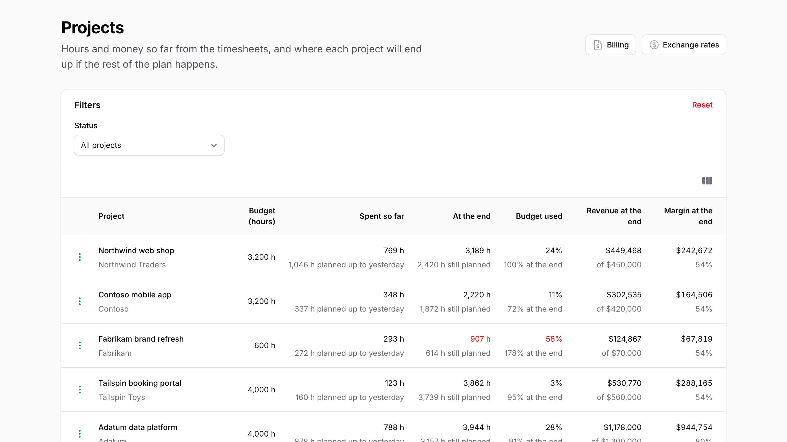

The *Projects* page lists your projects (a tentative one says *Tentative · 60%* under its name; the *Status* column can be shown from the column menu) with:

| Column | What it is |
| --- | --- |
| Budget (hours) | From the project’s settings. |
| Spent so far | Actual hours up to yesterday, with the hours planned up to yesterday under it. |
| At the end | Spent so far + the plan from today. Red when over budget. |
| Budget used | Spent so far ÷ budget, and the same at the end. Uses the money budget if there is one, otherwise the hours. |
| Revenue at the end | Hours at the end × bill rates (for billable projects), with the money budget under it. |
| Margin at the end | Revenue − hours × cost rates, and the margin in %. |

**Rates** are per hour: a person’s own rate, otherwise their role’s rate. Placeholders use their role’s rate. Non-billable projects (internal work) have cost but no revenue. The ⋮ menu at the start of each row has **Details**, **Phases**, **Work report**, **Settings**, the [template](#project-templates) actions and [**Share a read-only link**](#sharing-a-plan-with-a-client-read-only-links). **Details** shows a bar of spent, still planned and over budget, and each person’s planned, actual and remaining hours with their revenue and cost at the end. **Settings** sets tentative and the chance, the color in the planner, billable, and the budget in hours and money.

### Expenses and fixed price projects

Hours × rates is not the whole story of a project’s money. Two things add the rest; a project that uses neither keeps exactly the numbers it had.

**Expenses** (*Projects* → ⋮ → **Expenses**) are costs other than people’s time: a subcontractor, a licence, travel. Each line has a date, a kind, what it was for, the **cost** (in your base currency) and, if the client pays for it, the amount **charged to the client** (in the project’s currency).

- The cost is added to the project’s cost; the amount charged is added to its revenue (not on a non-billable project). The margin follows.
- A line dated before today is spent; a line dated today or later is expected and counts “at the end” only.
- **Details** shows the expenses so far and at the end, and how much of them the client pays.
- In [billing](#billing), every charged expense in the period is its own line (`kind` is `expense`), and **Mark as invoiced** marks it too, so it is not billed twice. An invoiced expense can no longer be changed under *Expenses*.
- Budgets in hours are not touched by expenses. A money budget is compared with revenue, so charged expenses count towards it.

**Fixed price** (*Projects* → ⋮ → **Settings** → *Fixed price*) is for a project the client pays an agreed amount for, whatever the hours.

- Revenue at the end is the agreed price (plus charged expenses) instead of hours × bill rates; cost is still hours × cost rates plus expenses. The margin shows what is really left.
- Revenue so far is the agreed price × hours done ÷ hours at the end.
- The hours of a fixed price project are **not** in the billing lines — you invoice the price on your own schedule. Its charged expenses still are.
- The project list says *Fixed price* under the name. A project is either fixed price or a [monthly fee with an hour range](#monthly-fees-with-an-hour-range), not both.

```php
use Qalainau\FilamentWarpCapacity\Expenses;

Expenses::add($project, amount: 1200, date: '2026-11-20', category: 'subcontractor', description: 'Illustrations', billedAmount: 1500);

Expenses::for($project);    // the project's expenses, by date
```

`category` is `subcontractor`, `license`, `travel` or `other`. `Expenses::add()` throws a `CapacityException` for an unknown project, a negative amount, a date that is not a date or an unknown kind. Changing and deleting expenses is for people who may manage the settings.

### Rate changes

Rates go up. To raise one without changing the money already earned, add a **rate change** instead of editing the rate: on a role (*Roles* → **Edit** → **Rate changes**) or on a person (*People* → **Edit**). Each change has a date and the new bill and cost rates:

| | Bill rate | Cost rate |
| --- | --- | --- |
| Role *Designer* | $120 | $55 |
| Rate change from Dec 1 | $130 | *(empty)* |

- Hours before Dec 1 — timesheets and the plan — are counted at $120; hours from Dec 1 at $130. A booking that runs across the date is split at it.
- An empty rate in a change keeps the one before it (here the cost stays $55).
- A person’s rate wins over their role’s, day by day: if Alice has her own $140 and the role changes to $130, Alice stays at $140. If Alice’s own bill rate is empty, she follows the role’s changes.
- The lists on *Roles* and *People* show the rate in effect today, with the next change under it (“From Dec 1, 2026: $130.00”).
- Editing the rate itself (not a change) is the rate from the very start, so it changes past money too. Use it to fix a typo.

People are counted with their current role on every day: moving someone to another role does not keep the old role’s rates for the past. Give the person their own rate change if that matters.

The currency is set with `->currency('JPY')`. To hide money (and the *Projects* page) altogether: `->financials(false)`.

### Other currencies

A project can be billed in another currency than the one set with `->currency()` (the base currency). In the project’s **Settings**, set **Invoice currency**, for example `EUR`; its budget amount is then in euros. Under **Exchange rates** at the top of *Projects*, give how much of each currency one unit of the base currency buys, from a date (USD → EUR 0.92 from Jan 1).

- Rates and costs stay in the base currency, so the margin is in the base currency.
- Revenue and the budget are shown in the project’s currency, converted at today’s rate; *Budget used* compares them in that currency.
- [Billing](#billing) converts each day’s hours at that day’s rate. Without a rate for the currency, lines stay in the base currency.

### Monthly fees with an hour range

Many staffing contracts bill a fixed fee per person per month, with an hour range: within 140–180 hours the fee is the price; hours above are billed extra, hours below are taken off. In the project’s **Settings**, turn on **Monthly fee with an hour range** and enter the fee, the range and how the rate outside it is found:

| | Extra hours (above the range) | Missing hours (below) |
| --- | --- | --- |
| **Upper and lower limit** (default) | fee ÷ upper limit | fee ÷ lower limit |
| **Middle of the range** | fee ÷ middle | fee ÷ middle |

A fee of 800,000 with 140–180 h: 200 h is 800,000 + 20 × 800,000 ÷ 180 = 888,888.89; 120 h is 800,000 − 20 × 800,000 ÷ 140 = 685,714.29. On the *Projects* page the revenue of such a project is the fee for every month a person works on it (planned or actual); the exact settlement is in [Billing](#billing), from the approved hours of each month.

## Phases and milestones

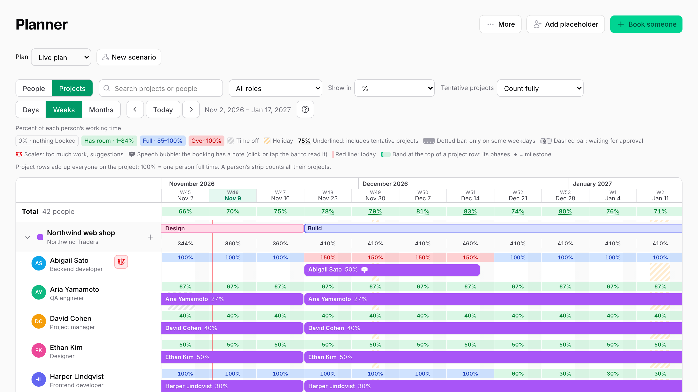

**Phases** on a project (on *Projects*) splits it into periods with their own budget — *Design*, *Build*, *Launch* — and adds **milestones**, single days such as *Go-live*.

- In the planner’s project view, phases are colored bands with their names at the top of the project’s row (the row grows to fit them), and milestones are diamonds. Point at one for its dates.
- A booking on a project with phases can say which phase it is for (**Phase** in the booking form).
- **Details** on the project lists each phase with its budget hours, the hours planned on it (bookings with that phase) and the actual hours in its dates. Planned or actual above the budget is red.
- Deleting a phase keeps its bookings; they just no longer have a phase.

## Project templates

Most projects of one kind look alike: the same phases, the same roles, a similar budget. A **project template** holds that once — phases and milestones, roles to book and a budget — so planning the next project is choosing a start date.

A template has no dates. Every phase and every booking says on which **day** it starts (day 0 is the day the project starts) and how many days it lasts. Days are calendar days, weekends included: a phase from day 14 starts two weeks after the project.

**Make one** under *Project templates* (in the settings group of the menu; for people who manage the settings), or open *Projects* and choose **Save as a template** in a project’s ⋮ menu. Saving from a project copies its phases, milestones, live bookings and budget, counted from the project’s earliest date. People are not copied: each person’s bookings become bookings for their role (*Designer*, and *Designer 2* for a second person with that role; *Team member* for someone without a role).

**Apply it** with **Plan with a template** in a project’s ⋮ menu on *Projects*, or **Apply to a project** on the template’s row. Choose the start date; a box says what will be added, when the plan ends and what the project already has. Then:

- Phases and milestones are added to the project.
- Each role to book becomes a booking on a [placeholder](#placeholders) in the planner — rows with the same role and name share one placeholder — ready to be replaced by a real person.
- The budget (hours and money), the color and *Billable* are copied to the project’s settings where the project has none yet. Turn on **Replace the project’s budget and color** to overwrite them.

What you should know:

- If the start date is a weekend or a public holiday (time off for everyone), the plan starts on the next working day. The form says so before you apply.
- What the project already has stays. Applying a template twice adds everything twice.
- A template is applied to the **live plan**, never to a scenario.
- If your bookings have to be [approved](#booking-requests-and-approval), the bookings a template adds wait for approval like any other.
- A role deleted since the template was made becomes a placeholder without a role.
- Changing or deleting a template does not change projects already planned with it.
- **Remove what a template added** in the project’s ⋮ menu deletes the phases, milestones and bookings of one application — also bookings since given to a real person — and puts back the budget the project had before, unless it was changed in the meantime. Bookings and phases you added by hand stay. Someone whose bookings need approval cannot remove an application once one of its bookings is confirmed.
- Creating, changing, applying and removing are for people who may manage the settings (`canManage()`), because a template writes phases and budgets. `->canManageTemplates(fn (User $user) => …)` gives it to other people, and `->templates(false)` turns templates off for a panel.
- A template has at most 50 phases and milestones and 100 roles to book; days go up to 3,650.

From code — for example to plan every new project when it is created:

```php
use Qalainau\FilamentWarpCapacity\Templates;

$template = Templates::create(
    name: 'Website build',
    phases: [
        ['key' => 'design', 'name' => 'Design', 'offset' => 0, 'length' => 14, 'budget_hours' => 80],
        ['key' => 'build', 'name' => 'Build', 'offset' => 14, 'length' => 28],
        ['name' => 'Go-live', 'kind' => 'milestone', 'offset' => 42],
    ],
    bookings: [
        ['role' => 'Designer', 'offset' => 0, 'length' => 14, 'amount' => 50, 'unit' => 'percent', 'phase' => 'design'],
        ['role' => 'Developer', 'offset' => 14, 'length' => 28, 'amount' => 6, 'unit' => 'hours_per_day', 'phase' => 'build'],
    ],
    budgetHours: 300,
    budgetAmount: 45000,
);

$template = Templates::fromProject($website, 'Website build');           // or copy a project you planned by hand

$application = Templates::apply($template, $project, startsOn: '2027-01-11');
Templates::undo($application);                                           // take it all away again
```

| Method | What it does |
| --- | --- |
| `Templates::create(name, phases, bookings, budgetHours, budgetAmount, billable, color, notes)` | Makes a template. A phase row: `name`, `kind` (`phase` or `milestone`), `offset`, `length`, `budget_hours`, `budget_amount`, `color`, `key` (what booking rows call it; defaults to the name). A booking row: `role` (a `Role`, its id, or a name — created if it does not exist — or `null`), `name` (of the placeholder; defaults to the role), `offset`, `length`, `amount` + `unit` as in `Bookings::book()` (or `minutes_per_day`), `phase` (a phase’s `key`), `note`, `skills`, `days`, `every_weeks`. |
| `Templates::update($template, …)` | The same arguments; replaces the rows. |
| `Templates::delete($template)` | Deletes it. Projects planned with it keep everything. |
| `Templates::fromProject($project, $name)` | A template from a project’s phases, live bookings and budget. |
| `Templates::preview($template, $project, $startsOn)` | What applying would do, without writing: start and end, counts, whether the start date moved, what the project already has. |
| `Templates::apply($template, $project, $startsOn, replaceSettings: false, requested: false)` | Applies it and returns the `TemplateApplication`. `requested: true` makes the bookings wait for approval. |
| `Templates::undo($application, requestsOnly: false)` | Removes what that application added. Returns `['bookings' => 3, 'phases' => 4, 'placeholders' => 2]`. |
| `Templates::applications($project)` | The applications of a project, newest first. |

`Templates` does not check permissions — do that where you call it — and throws a `CapacityException` with a message for the user when something is wrong (an unknown project, a start date that is not a date, more rows than allowed). Outside a panel (queues, commands) set the tenant first, as for `Bookings`.

## Sharing a plan with a client (read-only links)

A client wants to see when their project happens and who works on it, but should not sign in to your panel. On *Projects*, **Share a read-only link** in a project’s ⋮ menu makes an address that shows the plan of **that one project** to anyone who has it:

- the phases and milestones with their dates,
- who works on it, week by week, with the hours (confirmed bookings only),
- a **Print** button; the page prints on A4 landscape.

When you create a link you choose **who it is for** (a name only you see), **how long it works** (7 to 365 days) and **what the page shows**:

| Option | On | Off |
| --- | --- | --- |
| People’s names (on by default) | One row per person, with their role. | One row per role (“Designer”), hours added up. |
| Hours per week (on by default) | Hours in each week and a total. | A dot in the weeks someone is booked. |
| Budget and hours used (**off** by default) | The budget in hours and money, the hours spent so far and the hours at the end as planned. | No budget and no money at all. |

Never on the page, whatever you tick: rates, cost, revenue, margin, booking notes, requests waiting for approval, scenarios, other projects and other tenants.

How it is protected:

- The address holds a random 40-character key and is signed with your app key, so it cannot be guessed and the expiry in it cannot be changed. Only a hash of the key is stored: **the address is shown once**, when you create the link. If it is lost, make a new one.
- **Shared links** in the same menu lists a project’s links — who for, what they show, until when, how often they were opened — with **Revoke**. A revoked or expired link answers *404 Not Found* at once, the same answer as for a wrong address.
- A project can have 20 working links at a time.
- The page is sent with `noindex`, `no-store` and `no-referrer` headers, cannot be framed, and is limited to 60 requests a minute.
- Anyone who has the address can open it. Treat it like the document it replaces.
- Creating and revoking is for people who may manage the settings; `->canShare(fn (User $user) => …)` changes who. `->shareLinks(false)` turns sharing off for a panel: the menu entries disappear **and every link already handed out stops working**.
- The page is in the language of the person who made the link.

The address needs your app’s `APP_KEY` and `APP_URL` to stay the same. After rotating the key, old links stop working.

From code:

```php
use Qalainau\FilamentWarpCapacity\ShareLinks;

['url' => $url, 'link' => $link] = ShareLinks::create(
    $project,
    days: 30,                 // or expiresAt: '2027-03-31'
    name: 'Acme',
    names: true,
    hours: true,
    budget: false,
);

ShareLinks::for($project);    // the project's links, newest first
ShareLinks::revoke($link);    // 404 from now on
```

`ShareLinks` does not check permissions; do that where you call it. It throws a `CapacityException` for an unknown project, an expiry in the past or more than 365 days away, and a twenty-first working link.

## Billable utilization

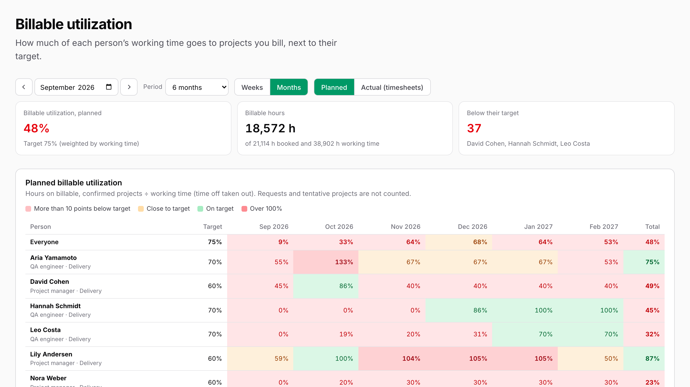

*Utilization* shows, for each person and month (or week), the share of their working time spent on **billable** projects, next to their **target**:

- **Planned** counts confirmed bookings; **Actual** counts submitted and approved timesheets. Requests and tentative projects are never counted. Non-billable projects (internal work) are what pulls the number down.
- Cells are red more than 10 points under the target, amber close to it, green at it, and red again over 100%. Hover a cell for the hours.
- The top shows everyone’s billable utilization against the target (weighted by working time), the billable hours, and who is below their target.
- The target is set per person (*People* → **Edit**), otherwise per role (*Roles*), otherwise with `->utilizationTarget(75)` (default 75%).

The `BillableUtilizationOverview` widget shows this month’s planned billable utilization, last month’s actual, and who is below target this month:

```php
use Qalainau\FilamentWarpCapacity\Widgets\BillableUtilizationOverview;

->widgets([BillableUtilizationOverview::class])
```

The page is hidden with `->financials(false)`.

## Billing

**Billing** on *Projects* turns approved hours into invoice lines and downloads them as Excel or CSV:

- One line per project and person (or role) with the hours, the average rate and the amount — each day at that day’s bill rate, in the project’s currency.
- For [monthly-fee projects](#monthly-fees-with-an-hour-range), one line per project, person and month with the hours, the fee, the range, the settlement and the amount.
- Non-billable projects are left out. By default only approved timesheets count; you can include submitted ones.
- [Expenses charged to the client](#expenses-and-fixed-price-projects) dated in the period are one line each (`kind` is `expense`, `expenses` holds the expense’s id, `hours` is 0). The hours of fixed price projects are left out.
- Fill in **Mark as invoiced** with your invoice number to mark those hours as invoiced: the next export leaves them out, unless you tick *Include hours already marked as invoiced*.

The same lines are available from code, for your invoicing:

```php
use Qalainau\FilamentWarpCapacity\Billing;

$lines = Billing::lines(from: '2026-11-01', to: '2026-11-30', projects: [$project], groupBy: 'person');
// [['kind' => 'hourly', 'project' => '12', 'project_name' => 'Website', 'name' => 'Alice', 'hours' => 42.5,
//   'rate' => 120.0, 'amount' => 5100.0, 'currency' => 'USD', 'entries' => [...], ...], ...]

$invoice = Invoice::createFromCapacity($lines);   // your code
Billing::markInvoiced($lines, $invoice->number);
Billing::unmarkInvoiced($invoice->number);        // when the invoice is cancelled
```

## Work reports

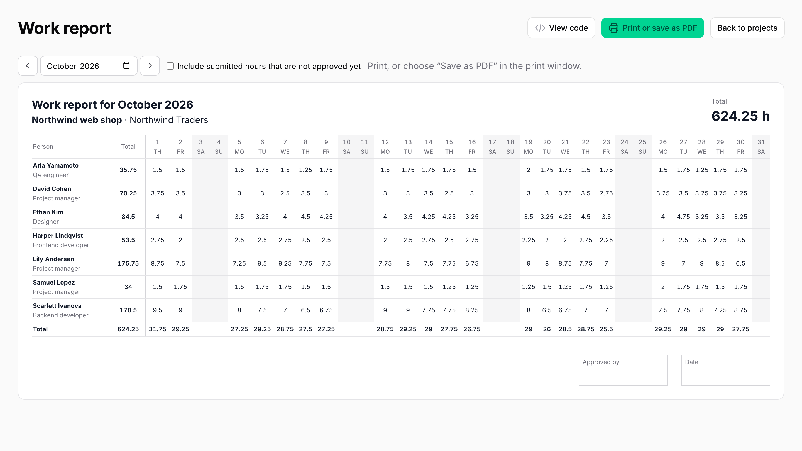

**Work report** on a project opens a monthly report for the client: one row per person, one column per day of the month, the totals, the notes from the timesheets, and boxes to sign. Choose the month at the top. By default only approved hours are shown. **Print or save as PDF** prints it in landscape A4 without the panel’s menus — choose *Save as PDF* in the print window to get a file.

With **Warp Print** you can design the report yourself and print it on your own paper. Make a source whose record is the project, and read the month from the request:

```php
use Qalainau\FilamentWarpCapacity\Domain\WorkReport;
use Qalainau\FilamentWarpPrint\Sources\Field;
use Qalainau\FilamentWarpPrint\Sources\PrintSource;

class WorkReportSource extends PrintSource
{
    protected static string $model = Project::class;

    public function fields(): array
    {
        $report = fn (Project $project) => WorkReport::for((string) $project->getKey(), request('month', now()->subMonth()->format('Y-m')));

        return [
            Field::text('name'),
            Field::text('month')->state(fn (Project $project) => $report($project)['month']),
            Field::number('total', decimals: 1)->state(fn (Project $project) => $report($project)['total'] / 60),
            Field::table('people', [
                Field::text('name'),
                Field::text('role'),
                Field::number('hours', decimals: 1)->state(fn (array $person) => $person['total'] / 60),
            ])->state(fn (Project $project) => $report($project)['people']),
        ];
    }
}
```

`WorkReport::for()` reads the approved hours (or your `actualsUsing()`), so the numbers are the same as on the built-in report.

## People, roles, time off and holidays

- **People** lists your people model. **Edit** sets their role, working hours for each weekday (a four-day week, part-time), their own bill and cost rates, joining and leaving dates, and skills with a level. **Set role** changes several people at once.
- **Roles** have a name, a color, default bill and cost rates (with [rate changes](#rate-changes)) and an order.
- **Tags** on a person (*People* → the person) are free labels to [filter the planner by](#skills-and-tags).
- **Time off and holidays**: with a person, it is their time off; without, it is a holiday for everyone (also for placeholders). Whole days or half days. Time off can also be added from the sun button on a person’s row in the planner.
- A person’s billable [utilization target](#billable-utilization) is set in **Edit** too.

## Calendar feeds

Let everyone see their bookings in Google Calendar, Outlook or Apple Calendar:

```php
FilamentWarpCapacityPlugin::make()->calendarFeeds()
```

*My timesheet* then has **Add to my calendar**: a private link to copy into the calendar app (*From URL* / *Subscribe from web* / *New calendar subscription*). The calendar shows each confirmed booking as an all-day event (“Website (4 h a day)”), [repeating bookings](#repeating-bookings) as repeating events, and the person’s time off and holidays as free time. Calendar apps fetch it again every few hours.

- The link has no login: anyone who has it can read that person’s bookings. That is why it is off by default. **Make a new link** stops the old one.
- It covers three months back and a year ahead. With tenancy, a link only ever shows its own team.
- The route is `GET /warp-capacity/calendar/{token}.ics` (named `warp-capacity.calendar`), limited to 60 requests a minute.

To go the other way — **read people’s own calendars as time off** — see [`IcsTimeOff`](#using-your-own-time-off-and-actuals).

## Importing from a CSV file

Moving from a spreadsheet or another tool? Two imports read CSV files (comma, semicolon or tab, with a header row; Excel’s BOM is fine). People and projects are found by their name (as shown in Warp Capacity, any case) or their ID.

**Bookings** — **More** → **Import bookings** in the planner:

```csv
person,project,from,to,amount,unit,note
Alice Martin,Website,2026-11-02,2026-11-27,50,percent,Kick-off
Bob Lee,Website,2026-12-01,2026-12-19,4,hours_per_day,
```

`amount` defaults to 100 and `unit` to `percent` (also `hours_per_day`, `hours_per_week`, `fte`). Each row is checked like a booking in the planner.

**Past hours** — **Import past hours** on *Timesheet approvals*:

```csv
person,project,date,hours,note
Alice Martin,Website,2026-10-05,7.5,Design review
Alice Martin,Website,2026-10-06,"6,5",
```

Each person’s week becomes an **approved** timesheet (so it counts as actuals right away). Weeks that already have a submitted or approved timesheet are skipped; a draft is added to.

Rows that cannot be read are skipped; afterwards you see how many were imported and the first skipped rows with the reason (“Row 4: Nobody called “Ann”.”). Up to 5,000 rows at a time.

To import with **Warp Import** instead (column mapping, previews, undo), write an importer whose `saveRecord()` calls `Bookings::book()` (see [Using it from code](#using-it-from-code)).

## On your own pages

**On a project’s page.** Add the summary of a project — spent, at the end, revenue, margin, the burn bar and the people — to your project resource’s infolist:

```php
use Qalainau\FilamentWarpCapacity\Schemas\ProjectCapacity;

public static function infolist(Schema $schema): Schema
{
    return $schema->components([
        // ...
        ProjectCapacity::make(),
    ]);
}
```

**On the dashboard.** `CapacityOverview` shows, for the next four weeks: how booked everyone is, who is overbooked, who has room, and the FTE still in unfilled placeholders. Each number links to the planner or *Demand and supply*.

```php
use Qalainau\FilamentWarpCapacity\Widgets\CapacityOverview;

->widgets([CapacityOverview::class])
```

**Billable utilization.** The `BillableUtilizationOverview` widget, see [Billable utilization](#billable-utilization).

**Linking projects.** `->projectUrl(fn (Project $project) => ProjectResource::getUrl('view', ['record' => $project]))` makes project names clickable in the planner and on the *Projects* page.

## Notifications

Warp Capacity can tell people about their plan:

| Notification | When | Sent by |
| --- | --- | --- |
| **Your plan has changed** — the projects that changed and their bookings for the next four weeks | Someone else books, moves or deletes their work in the live plan (not in a scenario, and not when they change their own bookings). One message per person once the changes stop for 10 minutes, so dragging a bar around sends one message, not ten. | `warp-capacity:send-plan-changes` |
| **Your week of …** — hours per project, the total against their working time, and their days off | Every Monday | `warp-capacity:send-week-ahead` |
| **Your timesheet … is not submitted** — the hours that were planned | People with planned work whose timesheet for the week is not submitted or approved | `warp-capacity:remind-timesheets` |
| **Your timesheet … was sent back** — with the reason | Right away, when an approver sends it back | — |

Turn them on in the plugin and say who receives them. People are often not users; `notifyUsing` returns the user (or anything [notifiable](https://laravel.com/docs/notifications)) for a person:

```php
FilamentWarpCapacityPlugin::make()
    ->people(Employee::class)
    ->notifications(
        channels: ['mail', 'database'],
        notifyUsing: fn (Employee $person) => $person->user,   // null: this person gets nothing
    )
```

If your people model is the user model and uses `Notifiable`, `notifyUsing` is not needed. The `database` channel puts them in the panel’s bell: add `->databaseNotifications()` to the panel and run `php artisan make:notifications-table` once. Each message has a button to the planner or to that week’s timesheet.

Then schedule the commands, for example in `routes/console.php`:

```php
use Illuminate\Support\Facades\Schedule;

Schedule::command('warp-capacity:send-plan-changes')->everyFifteenMinutes();
Schedule::command('warp-capacity:send-week-ahead')->weeklyOn(1, '8:00');
Schedule::command('warp-capacity:remind-timesheets')->weeklyOn(5, '15:00');
// or, the Monday after: ->remind-timesheets --last
```

- `send-plan-changes --quiet-minutes=10` waits until a person’s plan has not changed for that long. Changes are noted only while notifications are on; noted changes are deleted 30 days after they are sent.
- `send-week-ahead --week=2026-11-02` and `remind-timesheets --week=…` send for another week (any day of it). `remind-timesheets --last` reminds about last week.
- With tenancy, the commands send to each team through its panel, so people only see their own team’s projects and links. Panels using `tenantKeyUsing()` instead of Filament tenancy are not covered by the commands; the *sent back* message still works.
- Messages are written in each recipient’s language when the notifiable implements `HasLocalePreference`. They are sent as the command runs; to queue them, run the commands from a queued job.

## Using it from code

### Booking from your code

`Bookings` books, changes and deletes in the live plan with the same checks as the planner (people and projects of the current team, end on or after start, at most 24 hours a day). It throws `CapacityException` when something is wrong. It does not check permissions; do that in your code.

```php
use Qalainau\FilamentWarpCapacity\Bookings;

$booking = Bookings::book($employee, $project, from: '2026-12-01', to: '2026-12-19', amount: 50);            // 50% of their time
Bookings::book($employee, $project, '2026-12-01', '2026-12-19', amount: 4, unit: 'hours_per_day');
Bookings::book($employee, $project, '2026-12-01', '2027-03-31', amount: 1, unit: 'hours_per_day', days: [1], everyWeeks: 2);  // Mondays, every 2 weeks
Bookings::book($employee, $project, '2027-01-04', '2027-01-29', requested: true);                          // a request to approve

Bookings::placeholder('Designer', $project, '2027-01-04', '2027-02-26', amount: 0.5, unit: 'fte', skills: ['Figma']);

Bookings::update($booking, ['to' => '2026-12-23', 'amount' => 25]);       // person, project, from, to, amount + unit, note, phase, days, every_weeks
Bookings::delete($booking);
Bookings::approve($request, person: $otherEmployee);
Bookings::decline($request, 'Not this month');

Bookings::forPerson($employee, '2026-12-01', '2026-12-31');   // bookings in that period (requested: false for confirmed only)
Bookings::forProject($project, '2026-12-01', '2026-12-31');

[$first, $second] = Bookings::split($booking, '2026-12-10');   // first part ends on the 9th, second starts on the 10th
$result = Bookings::shiftProject($project, weeks: 2);          // every booking, phase and milestone two weeks later
```

`Bookings::split($booking, $on)` returns the two parts. `$on` must be after the booking’s first day and no later than its last.

`Bookings::shiftProject()` moves a project’s bookings in the live plan and returns `['bookings' => Collection, 'skipped' => int, 'phases' => Collection]`:

| Argument | Default | |
| --- | --- | --- |
| `$project` | | A project model or key. |
| `days`, `weeks` | `0` | How far; they add up. Negative moves earlier. At most 730 days in total, and not 0. |
| `phases` | `true` | Also move the project’s phases and milestones. |
| `from` | `null` | Only bookings and phases that start on or after this day. |
| `synced` | `false` | Bookings made with `Bookings::sync()` are left alone and counted in `skipped`, because the next `sync()` would move them back. Pass `true` when you shift your own records as well. |

```php
Bookings::shiftProject($project, days: -3, phases: false, from: now());   // what starts from today, three days earlier; phases stay
```

Units are `percent`, `hours_per_day`, `hours_per_week` and `fte`. People, projects and bookings can be models or keys.

**Outside the panel** — in a queued job, a command, a webhook — tell it which team:

```php
Bookings::forTenant($team, fn () => Bookings::book($employee, $project, '2026-12-01', '2026-12-19'));
```

### Events

Every change to the live plan — from the planner, a scenario being applied, a request being approved, or your code — fires an event with the booking (`$event->booking`). Changes inside a scenario do not.

| Event | When |
| --- | --- |
| `BookingCreated` | A booking (or request) was added. |
| `BookingUpdated` | Its dates, person, project, hours or note changed. |
| `BookingDeleted` | It was deleted. |
| `BookingRequested` | A request was made (after `BookingCreated`). |
| `BookingApproved` | A request was approved (instead of `BookingUpdated`). |
| `BookingDeclined` | A request was declined, with `$event->reason` (before it is deleted). |

All are in `Qalainau\FilamentWarpCapacity\Events`. For example, to create the matching task in your project tool:

```php
Event::listen(BookingApproved::class, fn (BookingApproved $event) => Jira::createEpicAssignment($event->booking));
```

### Following your own data (Warp Scheduler tasks, orders, …)

`Bookings::sync()` keeps **one** booking per record of yours. Call it again when the record changes and the same booking follows; `forget()` removes it. Such bookings show a link icon in the planner and cannot be dragged there (“Comes from Task: new homepage. Change it there.”), so the plan always matches your data.

With **Warp Scheduler**, book the assignee of each task for the task’s dates:

```php
use Qalainau\FilamentWarpCapacity\Bookings;

$scheduler
    ->afterEventCreated(fn (Task $task) => static::bookTask($task))
    ->afterEventMoved(fn (Task $task) => static::bookTask($task))
    ->afterEventUpdated(fn (Task $task) => static::bookTask($task))
    ->afterEventDeleted(fn (Task $task) => Bookings::forget($task));

protected static function bookTask(Task $task): void
{
    Bookings::sync(
        $task,
        person: $task->assignee_id,
        project: $task->project_id,
        from: $task->starts_at,
        to: $task->ends_at->subSecond(),           // the scheduler's end is exclusive
        amount: $task->hours_per_day,
        unit: 'hours_per_day',
        label: "Task: {$task->title}",
    );
}
```

### Importing with Warp Import

```php
use Qalainau\FilamentWarpCapacity\Bookings;

class BookingImporter extends Importer
{
    protected static ?string $model = Allocation::class;

    public static function getColumns(): array
    {
        return [
            ImportColumn::make('person')->requiredMapping(),
            ImportColumn::make('project')->requiredMapping(),
            ImportColumn::make('from')->requiredMapping()->rules(['date']),
            ImportColumn::make('to')->requiredMapping()->rules(['date']),
            ImportColumn::make('percent')->numeric(),
        ];
    }

    public function resolveRecord(): Allocation
    {
        return new Allocation;
    }

    public function fillRecord(): void
    {
        // Bookings::book() fills and checks the booking
    }

    public function saveRecord(): void
    {
        $this->record = Bookings::book(
            Employee::query()->where('name', $this->data['person'])->firstOrFail(),
            Project::query()->where('name', $this->data['project'])->firstOrFail(),
            $this->data['from'], $this->data['to'], $this->data['percent'] ?? 100,
        );
    }
}
```

## Who can do what

```php
FilamentWarpCapacityPlugin::make()
    ->canAccess(fn (User $user) => $user->hasRole('staff'))
    ->canPlan(fn (User $user) => $user->hasRole('planner'))
    ->canManage(fn (User $user) => $user->is_admin)
    ->canApproveTimesheets(fn (User $user) => $user->hasRole('manager'))
    ->canApproveBookings(fn (User $user) => $user->hasRole('resource-manager'))   // with ->bookingRequests()
```

| | Default |
| --- | --- |
| `canAccess` — open any Warp Capacity page; the others see none of them in the menu | Everyone who can open the panel |
| `canPlan` — book, move, split and delete, shift a project’s bookings, placeholders, scenarios, time off from the planner | Everyone who can open the panel |
| `canManage` — *People*, *Roles*, *Time off and holidays*, *Project templates* (making, applying and removing them; `canManageTemplates` changes who), read-only links for clients (`canShare` changes who), project settings, phases and milestones (also moving them when a project is shifted) | Whoever can plan |
| `canApproveTimesheets` — *Timesheet approvals*, closing timesheets, importing past hours | Whoever can plan |
| `canApproveBookings` — *Requests*; with `bookingRequests()`, people who can plan but not approve only make requests | Whoever can manage |

People who cannot plan still see the planner and can open a booking to read it. Everyone with a person in the plan has *My timesheet*.

To check these rules in your own code or tests, ask Warp Capacity of the current panel. Each check takes a user, or the signed-in user when you leave it out:

```php
use Qalainau\FilamentWarpCapacity\WarpCapacity;

WarpCapacity::get()->canPlan($user);              // true or false
WarpCapacity::get()->canManage($user);
WarpCapacity::get()->canApproveTimesheets($user);
WarpCapacity::get()->personFor($user);            // the user's person in the plan (what personForUser() returns), or null
```

`personFor()` returns `null` when the user has no person in the plan or their person belongs to another team. When your people are your users, it returns the user.

In feature tests that open the pages with `actingAs($user)->get(...)`, the user model must let the user into the panel (`implements FilamentUser` with `canAccessPanel()`); otherwise every page answers 403 and a test of the rules above passes for the wrong reason.

### Restricting pages per role

When your app has its own roles — for example "sales may use the planner, but only look at *Projects*" — decide for each Warp Capacity page who can open it and who can only look at it:

```php
use Qalainau\FilamentWarpCapacity\Pages\Planner;
use Qalainau\FilamentWarpCapacity\Pages\Projects;

FilamentWarpCapacityPlugin::make()
    ->canAccessUsing(fn (User $user, string $page): bool => $user->canOpen($page))
    ->canWriteUsing(fn (User $user, string $page): bool => ! $user->isReadOnlyOn($page))

// For example: sales may plan, but only look at the projects
    ->canWriteUsing(fn (User $user, string $page): bool => ! ($user->hasRole('sales') && $page === Projects::class))
```

Both closures receive the signed-in user as `$user` and the page class as `$page`. Leave them out and nothing changes.

**`canAccess()` and `canAccessUsing()` are two different rules.** `canAccess(fn (User $user) => …)` (above) says who may use Warp Capacity at all and gets no page. `canAccessUsing(fn (User $user, string $page) => …)` decides page by page. A page opens only when both say yes.

`$page` is one of:

| `$page` | Page |
| --- | --- |
| `Qalainau\FilamentWarpCapacity\Pages\Planner` | *Planner* |
| `…\Pages\Demand` | *Demand and supply* |
| `…\Pages\Baselines` | *Baselines* |
| `…\Pages\Projects` | *Projects* |
| `…\Pages\Utilization` | *Billable utilization* |
| `…\Pages\WorkReportPage` | The work report of a project |
| `…\Pages\MyTimesheet` | *My timesheet* |
| `…\Pages\TimesheetApprovals` | *Timesheet approvals* |
| `…\Pages\BookingRequests` | *Requests* (with `bookingRequests()`) |
| `…\Pages\People` | *People* |

*Roles*, *Time off and holidays* and *Project templates* are resources: restrict them with a policy, as for any Filament resource.

**When `canAccessUsing()` says no**, the page is gone from the menu, its URL answers 403, and a page that is already open answers 403 to its next click. The dashboard widgets no longer link to it, and the work report has no *Back to projects* button when *Projects* is closed.

**When `canWriteUsing()` says no**, the page opens but only for reading:

| Page | Hidden or refused (403) | Still works |
| --- | --- | --- |
| *Planner* | New booking, placeholder, time off and holiday, dragging, resizing, copying, deleting, splitting and shifting bookings, assigning placeholders, fixing an overbooked person, scenarios (new, apply, delete), importing a CSV file, *Save a baseline*. Opening a booking shows it read only. | Moving through time, zoom, units, filters, *Find who is free*, *Export*, your own saved views |
| *Baselines* | *Save a baseline*, *Delete* | *Compare* |
| *Projects* | Settings, phases and milestones, expenses, work types, templates (plan with, save as, remove), new read-only link, revoking a link, exchange rates; *Billing* does not mark hours as invoiced | *Details*, the list of read-only links, *Work report*, the *Billing* download |
| *My timesheet* | Save, submit, recall, the timer (start, stop, discard) | Moving between weeks, *Add to calendar* |
| *Timesheet approvals* | Approve, send back, approve selected, close and reopen timesheets, import past hours | Looking at a timesheet, the status filter |
| *Requests* | Approve, approve for someone else, decline, approve selected | The list |
| *People* | Editing a person, *Set role* | The list and the role filter |

*Demand and supply*, *Billable utilization* and the work report only show numbers, so `canWriteUsing()` changes nothing there.

Good to know:

- **These rules only narrow.** They are checked *and* the plugin's own rules (`canAccess`, `canPlan`, `canManage`, `canApproveTimesheets`, `canApproveBookings`, `canShare`, `canManageTemplates`). A yes from `canAccessUsing()` does not open *People* to someone who may not manage the settings, and a yes from `canWriteUsing()` does not let someone who may not plan book.
- Only people who can open a page can write on it: `canWriteUsing()` is asked only when `canAccessUsing()` said yes.
- Once you pass a rule, someone who is not signed in gets no for every page.
- *Save a baseline* in the planner's *More* menu needs both the *Planner* and the *Baselines* page to be writable.
- The rules belong to the panel: each panel's `FilamentWarpCapacityPlugin::make()` has its own.


**Your own policies count too.** When your app has a policy for a model of this plugin, the project templates and the roles and time off settings (`TemplateResource`, `RoleResource`, `TimeOffResource`) also ask it (`viewAny`), together with the plugin's own options — so a role that may not use the screen gets a 403 there too. Without a policy nothing changes (also with Filament's `strictAuthorization()`).

## Plugin options

| Method | |
| --- | --- |
| `people(...)`, `projects(...)`, `personForUser(...)` | See [Quick start](#quick-start). |
| `projectUrl(fn)` | Where a project name links to. The closure gets the project as `$project` or `$record`. |
| `workWeek([...])` | Default working hours Monday to Sunday. Default `[8, 8, 8, 8, 8, 0, 0]`. |
| `fullTimeHoursPerDay(float)` | A full-time day for FTE and person-months. Default `8`. |
| `defaultUnit(Unit)` | `Unit::Percent` (default), `Unit::Hours`, `Unit::Fte` or `Unit::PersonMonths`. Each user’s last choice is remembered. |
| `currency(string)` | ISO code. Default `USD`. |
| `canAccess`, `canPlan`, `canManage`, `canApproveTimesheets` | See [Who can do what](#who-can-do-what). |
| `timesheets(bool)`, `financials(bool)`, `settings(bool)` | Hide the timesheet pages, the money and *Projects* page, or the settings screens. |
| `templates(bool)`, `canManageTemplates(fn)` | Turn [project templates](#project-templates) off (no screen, no route, no template actions on *Projects*), or say who may make, apply and remove them. Default: on, for whoever can manage. |
| `shareLinks(bool)`, `canShare(fn)` | Turn [read-only links](#sharing-a-plan-with-a-client-read-only-links) off (no menu entries, and links already handed out answer 404), or say who may create and revoke them. Default: on, for whoever can manage. |
| `demand(bool)`, `baselines(bool)` | Hide *Demand and supply* (with the hiring forecast) or *Baselines* (and *Save baseline* in the planner). Hidden pages get no route. |
| `navigationGroup(string\|Closure)`, `settingsNavigationGroup(string\|Closure)` | The menu headings. Pass a closure such as `fn () => __('Resourcing')` when the heading must follow each user's language (see below). |
| `notifications(channels:, notifyUsing:)` | See [Notifications](#notifications). |
| `bookingRequests()`, `canApproveBookings(fn)` | See [Booking requests and approval](#booking-requests-and-approval). |
| `utilizationTarget(int)` | The billable utilization target in %, for people and roles without their own. Default `75`. |
| `hiringLeadTime(int)` | Weeks hiring takes, for the [hiring forecast](#hiring-forecast). Default `8`. |
| `calendarFeeds()` | Turn on [calendar feeds](#calendar-feeds). Off by default. |
| `timeOffUsing(fn)`, `actualsUsing(fn)` | See below. |
| `tenantKeyUsing(fn)` | See [Multi-tenancy](#multi-tenancy). |

**Menu headings in the user's language.** The panel is configured before your app picks the user's language (`App::setLocale()` in a middleware), so `->navigationGroup(__('Resourcing'))` is translated once, in the default language, and stays that way. Pass a closure instead; it runs each time the menu is drawn, after the language is set. Use the same text as your own resources' groups so they share one heading:

```php
FilamentWarpCapacityPlugin::make()
    ->navigationGroup(fn () => __('Resourcing'))
    ->settingsNavigationGroup(fn () => __('Settings'))
```

Leave them out to get the plugin's own headings, which are translated already.

With several panels, each panel keeps its own options.

## Using your own time off and actuals

If time off already lives in your app (or in Warp Scheduler), add it to the calendar:

```php
->timeOffUsing(fn (array $people, CarbonImmutable $from, CarbonImmutable $to) => Absence::query()
    ->whereIn('employee_id', $people)
    ->where('starts_on', '<=', $to)->where('ends_on', '>=', $from)
    ->get()
    ->map(fn (Absence $absence) => [
        'person' => (string) $absence->employee_id,   // null for everyone
        'starts_on' => $absence->starts_on,
        'ends_on' => $absence->ends_on,
        'minutes_per_day' => $absence->half_day ? 240 : null,   // null for whole days
    ])
    ->all())
```

It is added to the time off and holidays entered in Warp Capacity.

**From people’s own calendars.** `IcsTimeOff` reads time off from iCal links (Google Calendar’s *secret address*, an Outlook *published calendar*, a holiday calendar):

```php
use Qalainau\FilamentWarpCapacity\Support\IcsTimeOff;

->timeOffUsing(IcsTimeOff::from(
    fn (array $people) => Employee::query()->whereKey($people)->pluck('vacation_calendar_url', 'id')->all(),   // person key => URL
    filter: fn (string $title) => str_contains(strtolower($title), 'vacation') || str_contains($title, '休'),
))
```

All-day events are whole days off; a shorter event takes its hours off that day (6 hours or more is a whole day). Each calendar is read at most once an hour (`cacheMinutes:`); one that cannot be read is skipped. Repeating events (`RRULE`) are not expanded.

People often type these links themselves, so only public addresses are read: a link to the server's own network — `localhost`, `10.…`, `192.168.…`, the cloud metadata address `169.254.169.254`, also through a redirect — is skipped, and the request goes to the very address that was checked. A file over 5 MB is not read. If your calendars live on a server inside your network, pass `privateNetwork: true`.

If hours are already tracked elsewhere, use them as the actuals instead of the timesheets:

```php
->actualsUsing(fn (CarbonImmutable $from, CarbonImmutable $to, ?array $projects, ?array $people) => TimeLog::query()
    ->whereBetween('date', [$from, $to])
    ->when($projects, fn ($query) => $query->whereIn('project_id', $projects))
    ->get()
    ->map(fn (TimeLog $log) => ['person' => $log->employee_id, 'project' => $log->project_id, 'date' => $log->date, 'minutes' => $log->minutes])
    ->all())
```

## Multi-tenancy

Warp Capacity works with [Filament’s multi-tenancy](https://filamentphp.com/docs/users/tenancy), so one app can hold the plans of many teams or companies (a SaaS). Each team sees only its own people, projects and plan — never another team’s.

### Set up the panel

```php
use App\Models\Employee;
use App\Models\Project;
use App\Models\Team;
use Filament\Facades\Filament;

public function panel(Panel $panel): Panel
{
    return $panel
        ->id('app')
        ->path('app')
        ->tenant(Team::class)                       // or ->tenant(Team::class, slugAttribute: 'slug')
        ->plugin(
            FilamentWarpCapacityPlugin::make()
                ->people(Employee::class, title: 'name', query: fn ($query) => $query->where('active', true))
                ->projects(Project::class, title: 'name')
                ->personForUser(fn (User $user) => Employee::query()
                    ->whereBelongsTo(Filament::getTenant())
                    ->where('user_id', $user->id)
                    ->first()),
        );
}
```

```php
class Employee extends Model
{
    public function team(): BelongsTo
    {
        return $this->belongsTo(Team::class);
    }
}

class Project extends Model
{
    public function team(): BelongsTo
    {
        return $this->belongsTo(Team::class);
    }
}
```

That is all. The panel’s other settings (the tenant menu, registration, billing) are Filament’s as usual.

### What is kept per team

- **Everything Warp Capacity stores:** bookings, placeholders, scenarios, time off and holidays, roles and rates, people’s settings (role, working week, skills), project settings and budgets, timesheets and their hours. Each row gets the team in `tenant_type` (the model’s morph class) and `tenant_id` (its key) when it is saved and is only read back for that team.
- **Your people and projects:** the planner, the forms, *People*, *Projects*, *Demand and supply*, *Find someone*, the Excel download and the dashboard widget only show the team’s people and projects. Warp Capacity limits them for you, the same way Filament limits a resource: through the panel’s *ownership relationship* — `team` for `->tenant(Team::class)`, or what you pass as `ownershipRelationship:`.
- **What comes from the browser:** a booking, a person, a project, a placeholder, a scenario or a timesheet of another team is refused, even when someone sends its ID by hand.

### Your people and project models

Warp Capacity needs to know how a person or a project belongs to a team. By default it uses the panel’s ownership relationship, so a `team()` relationship on the model is enough. Other cases:

| Your model | What to write |
| --- | --- |
| `team()` belongs to the team (a `team_id` column) | Nothing more. |
| Another name, e.g. `company()` | `->people(Employee::class, tenantRelationship: 'company')` |
| People are your users, in many teams (`teams()`, many-to-many) | `->people(User::class, tenantRelationship: 'teams')` — a user in two teams is planned separately in each. |
| You limit it yourself | `->projects(Project::class, query: fn ($query) => $query->whereBelongsTo(Filament::getTenant()), tenantRelationship: false)` |

If the model has no such relationship, Warp Capacity stops with an error that names the missing relationship, instead of showing every team’s people. The `query:` argument still works as before: it is applied **after** the team limit (for example, to leave out people who have left).

### Columns

Warp Capacity’s own tables already have `tenant_type` and `tenant_id` columns (from its migration); there is nothing to add. Both are strings, like the columns for people and projects, so integer, UUID and ULID keys all work. The unique keys (a person’s settings, a project’s settings, a timesheet per week) include both columns. Rows saved without a team have both empty. Your people and project tables need whatever your relationship uses — usually a `team_id` column, or a pivot table such as `team_user` for users in many teams.

### Outside the panel: `tenantKeyUsing()`

In a queue job, a command or a scheduled task there is no current Filament tenant. Say which team applies:

```php
->tenantKeyUsing(fn () => app(CurrentTeam::class)->id)
```

Return the team itself or its key. A key is stored with the panel’s tenant model as `tenant_type`, so it matches the rows saved in the panel.

Or set the panel and its tenant yourself at the start of the job:

```php
Filament::setCurrentPanel('app');
Filament::setTenant($team, isQuiet: true);
```

Outside a request, Warp Capacity uses the options of the **default** panel unless you set the current panel — so with several panels, set it in jobs that work for the team panel.

`tenantKeyUsing()` is also how to use Warp Capacity with a tenancy of your own instead of Filament’s: return your tenant’s key, and limit your people and projects in `query:` (with `tenantRelationship: false`, or a relationship name). In a panel without Filament tenancy, rows are stored with `custom` as `tenant_type`; if your app has two kinds of such tenants, make their keys different yourself.

### Good to know

- **Different tenant models stay apart.** Two panels with different tenant models (`Team` and `Company`) on the same database never mix their rows, even when the IDs are the same, because `tenant_type` is stored too.
- **Each panel has its own settings.** You can have a panel without tenancy next to the team panel; configure the plugin in each. A panel without tenancy only shows what was saved without a team (it never shows the teams’ plans). In a queue job or a command without a tenant, nothing is limited.
- **`personForUser` must look in the current team.** If it returns someone of another team, *My timesheet* says the user is not in the plan.
- **Your own callbacks see only what you return.** `timeOffUsing()` and `actualsUsing()` receive the team’s people and projects, but the query inside is yours: limit it to the team too.
- **A team switch keeps nothing.** Moving to another team in the tenant menu shows that team’s plan; nothing of the previous team stays on screen.

## Requirements

- PHP 8.3+
- Laravel 12 or 13
- Filament 5.8.3 or later
- SQLite, MySQL 8.0+, MariaDB 10.11+ or PostgreSQL 14+

### Tested on

Before each release, the full test suite runs on PHP 8.3, 8.4 and 8.5 × Laravel 12 and 13 × SQLite, MySQL, MariaDB and PostgreSQL, with each database at its newest and its oldest supported version: 42 combinations in all. A version is released only when every combination passes.
[See the results for each release](https://github.com/qalainau-labs/filament-warp-capacity-docs/tree/main/test-runs).

The interface is in English, Japanese, German, French, Spanish, Italian, Brazilian Portuguese, Korean and Chinese (simplified and traditional).

## Support

Questions before or after buying: [warpui.com/support](https://warpui.com/support?plugin=capacity).

## License

Warp Capacity is a commercial plugin. See [LICENSE.md](LICENSE.md).
